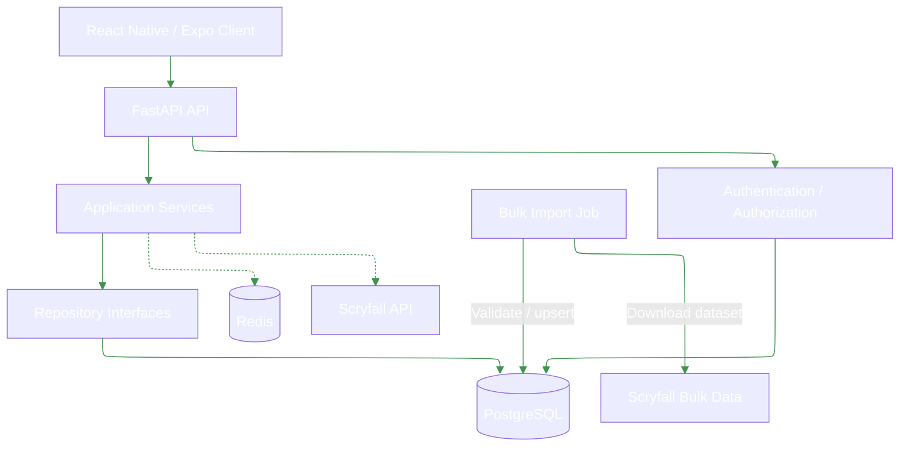

# Arcane Archive – MTG Companion App

**Backend API and card-data services for the Arcane Archive mobile application.**


Arcane Archive is a Magic: The Gathering(MTG) companion app. It is a user-friendly mobile application that is designed 
to enhance an MTG player's experience that helps users manage their card collections, create wishlists, build decks, and 
track their games.  In addition to these features, an AI Deck Builder is planned for future implementation.

The backend uses PostgreSQL to persist card data and user information. Scryfall API is integrated to provide card 
information and images by using the bulk data download feature. An AI-assisted deck builder is planned for future
implementation.


## Objectives

- Library Management: Provide a card library so users can manage card collections, including library 
  organization, wish lists, card collections, and set management.
- Card Search: Offer both an advanced and simple user-friendly search feature that allows users to easily find specific 
  cards or sets. 
- Game Tracker: Include essential game tools such as a multi-player game tracker that tracks a player’s name, damage, tax,
  mana count, counters, life counter, and other game stats.
- Deck Builder: Provide a comprehensive deck building feature with the ability to save the deck to a user’s library.
- User Accounts: Support private user accounts, profiles, collections, wishlists, and saved decks.
- Card Scanner: Provide a card scanner to easily add cards to a user’s library.
- Mobile Support: Support mobile devices and platforms with user-friendly design.
- Reliable Card Data: Integrate Scryfall API reference data through controlled API access and bulk data ingestion.

## Target Audience & Access

Arcane Archive is designed for casual, competitive, and Commander MTG players who want to manage their card collections,
build decks, search cards and sets, and track their games. Card browsing and searching are always available for free, 
but users must create an account to access the full features of the application.

**Age Range 8+:** The application is designed to be enjoyable for users of all ages, from children to adults. Users 
under 13 years old must have parental consent and approval to create an account and use the application.

## Overview
Arcane Archive is a mobile application for Magic: The Gathering players, built with React Native, TypeScript, Expo, and 
FastAPI. Players can create a profile where their game stats, card library, wish lists, and other preferences are stored. 
Arcane Archive offers an advanced and simple search feature, a deck builder, user profile, card library, card scanner, 
and the ability to create wishlists. The app also includes a multi-player game tracker that tracks a player’s name, 
damage, tax, mana count, counters, a life counter, and other stats. Integrated with Scryfall API, Arcane Archive 
provides daily updates to the most current card data.

## Features 

| Feature                             | Scope                                                        |
|-------------------------------------|--------------------------------------------------------------|
| FastAPI Backend                     | HTTP routers, pydantic schemas, and OpenAPI support          |
| Local user authentication           | JWT-based authentication with password hashing and salting   |
| Firebase social authentication      | OAuth2-based authentication with Google, Facebook, and Apple |
| Simple & Advanced Search            | Search for cards by name, set, or other criteria             |
| Scryfall API Integration            | Bulk downloads, normalization, and database upserts          |
| Player Profile Management           | User profile management, preferences, and game stats         |
| Card Library Management             | Manage card collections, wishlists, and sets                 |
| Wishlist Management                 | Create, edit, and delete wishlists                           |
| Deck Builder                        | Create, edit, and manage decks                               |
| Card Scanner                        | Scan cards to add to the user's library                      |
| Redis Caching                       | Cache-aside for public card data                             |
| pgVector & AI Deck Builder (Future) | Store AI-generated card embeddings for semantic search       |
| pgBouncer & pgBackRest              | Connection pooling and backup/recovery for PostgreSQL        |

## Installation and Setup

These instructions apply to the backend API. For the mobile app setup information, please refer to the frontend API 
documentation.

### Prerequisites

1. Git
2. Python 3.11 or higher
3. Poetry for dependency management and virtual environment management
4. PostgreSQL 15 or higher
5. Redis
6. Firebase Account (Optional)
7. Docker & Docker Compose

### Install Poetry

Install Poetry using the official installer → [Poetry Installation Guide](https://python-poetry.org/docs/#installation)

```bash
pip install poetry
```

### Clone the Repository

```bash
    git clone https://github.com/ARMummert/arcane-archive-backend.git
    cd ./arcane-archive-backend
```

### Verify Poetry Version
If you don't have Poetry installed yet, you can install it via the official installer.

```bash
poetry --version
```

### Create a Poetry Virtual Environment
```bash
poetry env activate

poetry env info
```

This should show you the path to the virtual environment, which should be .venv in the project directory. If it doesn't, 
you can set it to be in the project directory with:

```bash
poetry config virtualenvs.in-project true
   
source .venv/bin/activate
```

### Install Dependencies
```bash
poetry install 
```

### Check Docker Configuration
```bash
docker --version
docker-compose --version
docker compose config --services
```git@github.com:ARMummert/arcane-archive-frontend.git

### Start the Docker Containers
```bash
docker-compose up -d
```

### Environment Configuration

1. Copy the .env.example file into the root directory.
   ```bash
   cp .env.example .env
   ```

2. Enter your database configuration in the .env file.
   
   ```bash
   DB_USER=Username
   DB_PASSWORD=Password
   DB_HOST=localhost
   DB_PORT=5432
   DB_NAME=arcane_archive_db
   ```
   
3. Create a separate .env.test file in the test directory for testing purposes.

   ```bash
   TEST_DB_USER=Username
   TEST_DB_PASSWORD=Password
   TEST_DB_HOST=localhost
   TEST_DB_PORT=5432
   TEST_DB_NAME=arcane_archive_db_test
   ```
   
### Firebase Configuration

1. Signup or Signin to your Firebase Project and create a Service Account Key.
2. Configure the provider and mobile-client settings as required by
   [Firebase ADM SDK](https://firebase.google.com/docs/admin/setup#initialize-sdk).
3. Configure the backend Firebase ADM SDK using firebase_config.py in the config directory.
4. Save the Service Account Key as service_account.json in the config directory.
5. Make sure you add the ./config directory to your .gitignore file.
6. Verify that the backend can validate a Firebase ID token from the correct project.

See the [Firebase Authentication Guide](https://firebase.google.com/docs/auth/admin/verify-id-tokens) and
[Firebase ADM SDK](https://firebase.google.com/docs/admin/setup#initialize-sdk) documentation for more information.

### Database Migrations

1. Generate the Alembic.ini file in the root directory and edit it to reflect your database configuration.

    ```bash
     poetry run alembic init alembic
    ```

2. Run your database migrations through the Poetry-managed environment.

   ```bash
    poetry run alembic upgrade head
    poetry run alembic current
   ```

3. To create a new migration, run the following command:

   ```bash
    poetry run alembic revision --autogenerate -m "Migration message"
   ```
   
4. To downgrade the database to a previous migration, run the following command:

   ```bash
    poetry run alembic downgrade <revision>
   ```

5. To view the current revision of the database, run the following command:

   ```bash
    poetry run alembic current
   ```

See the [Alembic Documentation](https://alembic.sqlalchemy.org/en/latest/) for more information on Alembic.

### Initialize Card Data

Run the repositories bulk data ingestion script to download and ingest the Scryfall bulk data into the PostgreSQL database.

```bash
poetry run python scripts/ingest_bulk_data.py
```
   
### Launch the API

1. Start the development server. 

```bash
 poetry run uvicorn main:app --reload --host 127.0.0.1 --port 8000
```

### Run Tests

```bash
poetry run pytest
```
   
## API Documentation

- [Swagger UI](http://127.0.0.1:8000/docs)
- [OpenAPI JSON](http://127.0.0.1:8000/openapi.json)

## System Overview

### Technology Stack

| Layer                 | Technology                                  | 
|-----------------------|---------------------------------------------|
| Mobile App            | React Native, Expo, TypeScript              | 
| Backend API           | FastAPI, Uvicorn                            |
| Language              | Python                                      |
| Validation            | Pydantic v2                                 |
| Database              | PostgreSQL                                  | 
| ORM                   | SQLAlchemy 2.0                              |
| Migrations            | Alembic                                     |
| Dependency Management | Poetry                                      |
| Authentication        | Password hashing, JWT, Firebase Social Auth |
| Data Source           | Scryfall API and bulk data                  | 
| Cache                 | Redis                                       | 
| Testing               | Pytest, Pytest-asyncio                      |
| Containerization      | Docker                                      |

### **Scryfall API Integration:** 

To adhere to Scryfall's API usage policies:

- **Daily Updates with ETL Pipeline:** Provides daily updates to a full library of MTG cards and sets via ETL Pipeline.
- **Rate Limiting:** Request handling with built-in 100 ms rate-limiting  
- **Local Storage:** Stores card data locally for efficient retrieval and to ensure rate limiting compliance.
- **User Agent:** ArcaneArchive/1.0; contact:dev@example.com

## Core API Endpoints

| Endpoint              | Method | Description                                            |
|-----------------------|--------|--------------------------------------------------------|
| /cards/search         | GET    | Search for cards by name, set, or other criteria       |
| /cards/{oracle_id}    | GET    | Get card details by Oracle ID                          |
| /register             | POST   | Register a new user                                    |
| /user_accounts        | GET    | Get the authenticated user's account details           |
| /user_accounts/login  | POST   | Authenticate a user and return a token                 |
| /user_accounts/logout | POST   | Logout the authenticated user and invalidate the token |

## High-Level System Architecture



## API Access & Rate Limiting

Requests to Scryfall API require a user agent string that identifies the application and provides the developer's 
contact information: `ArcaneArchive/1.0; contact: armummert4@gmail.com`. It also must include an `Accept` header. 
Scryfall enforces a rate limit of 10 requests per second per IP address. To comply with this, Arcane Archive implements
a rate-limiter and bounded backoff to protect against too many requests. Bulk exports are preferred over issuing 
individual API requests. 

## License and Attribution

Arcane Archive is documented as an MIT-licensed project.

Magic: The Gathering and associated intellectual property are owned by 
[Wizards of the Coast LLC](https://company.wizards.com/en/legal/intellectualproperty). Arcane Archive is an 
unofficial fan project and is not approved or endorsed by Wizards of the Coast. Use of MTG materials is subject to the 
[Wizards of the Coast Fan Content Policy](https://company.wizards.com/en/legal/fancontentpolicy).

Card information and images are sourced through [Scryfall](https://scryfall.com). Scryfall is a third-party service and
does not endorse Arcane Archive. Integrations and displayed content are subject to applicable Scryfall usage and 
attribution requirements.

# References

[1] [Scryfall API Documentation](https://scryfall.com/docs/api)

[2] [Scryfall Bulk Data](https://scryfall.com/docs/api/bulk-data)

[3] [Scryfall API Rate Limits](https://scryfall.com/docs/api/rate-limits)

[4] [Scryfall API Terms of Service](https://scryfall.com/docs/api/terms-of-service)

[5] [SOLID Principles](https://www.educative.io/courses/grokking-nodejs-design-patterns-interview/the-solid-principles?utm_term=&utm_campaign=%5BNew+-+Mar+24%5D+Brand+Core+Performance+Max&utm_source=adwords&utm_medium=ppc&hsa_acc=5451446008&hsa_cam=21099703438&hsa_grp=&hsa_ad=&hsa_src=x&hsa_tgt=&hsa_kw=&hsa_mt=&hsa_net=adwords&hsa_ver=3&gad_source=1&gad_campaignid=21089679273&gbraid=0AAAAADfWLuTbsmqmcbl__NU46v6gbqzBt&gclid=Cj0KCQiAwdDXBhDuARIsAFdLukmnOU6EwFDIUf2sLaYWhCMsrXM_vLegr8qrXQBJ5aE1k0uRwAqywrEaAgZnEALw_wcB)

[6] [Repository Pattern](https://www.educative.io/courses/grokking-nodejs-design-patterns-interview/the-repository-pattern?utm_term=&utm_campaign=%5BNew+-+Mar+24%5D+Brand+Core+Performance+Max&utm_source=adwords&utm_medium=ppc&hsa_acc=5451446008&hsa_cam=21099703438&hsa_grp=&hsa_ad=&hsa_src=x&hsa_tgt=&hsa_kw=&hsa_mt=&hsa_net=adwords&hsa_ver=3&gad_source=1&gad_campaignid=21089679273&gbraid=0AAAAADfWLuTbsmqmcbl__NU46v6gbqzBt&gclid=Cj0KCQiAwdDXBhDuARIsAFdLukmnOU6EwFDIUf2sLaYWhCMsrXM_vLegr8qrXQBJ5aE1k0uRwAqywrEaAgZnEALw_wcB)

[7] [SOLID – The first five principles of Object-Oriented Design](https://www.digitalocean.com/community/conceptual-articles/s-o-l-i-d-the-first-five-principles-of-object-oriented-design)

[8] [Wizards of the Coast Fan Content Policy](https://company.wizards.com/en/legal/fancontentpolicy)

[9] [Wizards of the Coast Intellectual Property](https://company.wizards.com/en/legal/intellectualproperty)

[10] [Modular Monolith](https://www.dandoescode.com/blog/modular-monolith/a-gentle-introduction)
