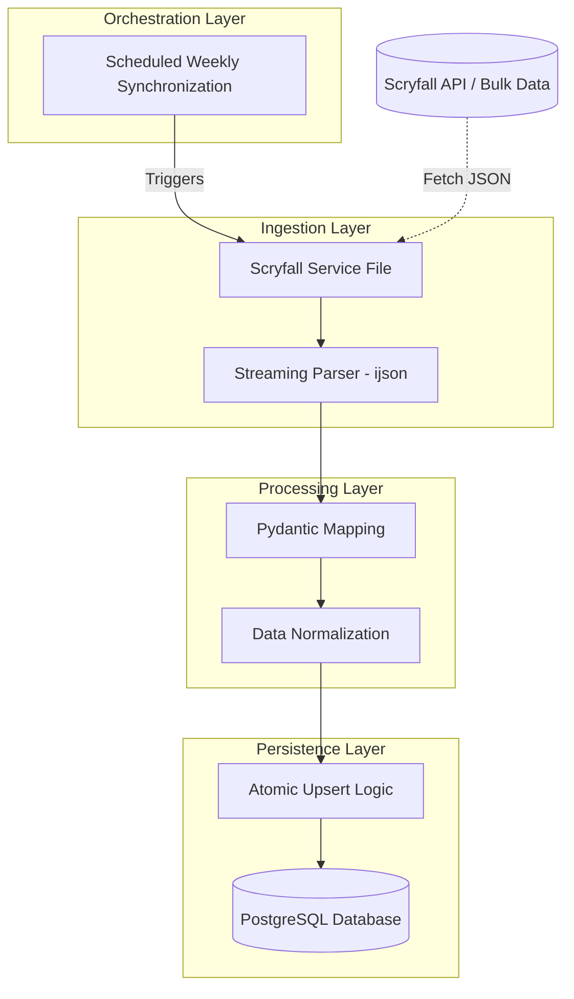
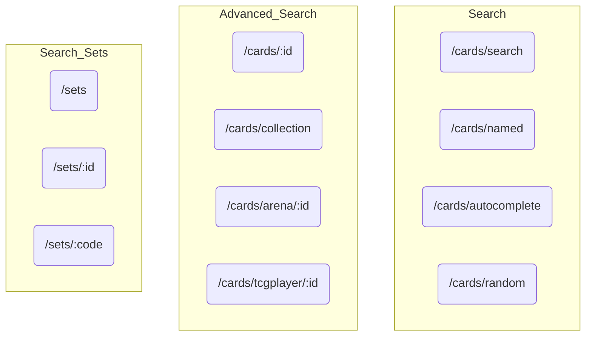

# Scryfall API Documentation

---
### Scryfall's API Usage policies require strict adherence to rate limiting and ethical usage guidelines. 
### Scryfall API Documentation: https://scryfall.com/docs/api
To maintain a healthy relationship with Scryfall and avoid IP bans, the Scryfall Service implements the following constraints:

### Table of Contents
- [Technical Requirements](#technical-requirements)
- [Content and Usage Restrictions](#content-and-usage-restrictions)
- [Image Usage Restrictions](#image-usage-restrictions)
- [The Arcane Archive Data Contract](#the-arcane-archive-data-contract)
- [API Endpoints Overview](#api-endpoints-overview)
- [Legal Disclaimer](#legal-disclaimer)

### Technical Requirements
1. **User-Agent Header:** All requests must include the header: User-Agent: ArcaneArchive/1.0; contact:dev@example.com
2. **Agent Header:** All requests must include the header: Agent: ArcaneArchive/1.0
> The Accept header must be present, but you can provide a generic preference. For example, both of these are okay: Accept: */* and Accept: application/json;q=0.9,*/*;q=0.8
3. **HTTPS:** All requests must use HTTPS
4. **Rate Limiting:** Every outgoing request from the FastAPI backend must be preceded by a minimum 50 – 100 milliseconds of delay between the requests you send to the server at api.scryfall.com
5. **Batching:** Arcane Archive uses the /cards/collection endpoint for inventory updates to minimize the total request count.
6. **Data Caching:** To minimize requests, you are encouraged to cache data locally for at least 24 hours. Daily bulk data files are available for download for full database access. 

> **Backoff Strategy:** In the event of a 429 (Too Many Requests) response, the system implements an Exponential Backoff strategy, pausing all outgoing requests for a specified duration before retrying.

---
### Content and Usage Retrictions

When using Scryfall data, you must adhere to the following guidelines:

> - You may not use Scryfall logos or use the Scryfall name in a way that implies Scryfall has endorsed you, your work, or your product.
> - You may not “paywall” access to Scryfall data. You may not require anyone to make payments, take surveys, agree to subscriptions, rate your content, join chat servers, or follow channels in exchange for access to Scryfall data. If you have an account system, end-users should be able to access card data anonymously or with free accounts.
> - You may not use Scryfall data to create new games, or to imply the information and images are from any other game besides Magic: The Gathering.
> - You may not simply repackage, republish, or proxy Scryfall data. Your software must create additional value for end-users.

When using images from Scryfall, you must adhere to the following guidelines:

> - Do not cover, crop, or clip off the copyright or artist name on card images.
> - Do not distort, skew, or stretch card images.
> - Do not blur, sharpen, desaturate, or color-shift card images.
> - Do not add your own watermarks, stamps, or logos to card images.
> - Do not place card images in a way that implies someone other than Wizards of the Coast created the card or that it is from another game besides Magic: The Gathering.
> - When using the art_crop, list the artist name and copyright elsewhere in the same interface presenting the art crop, or use the full card image elsewhere in the same interface. Users should be able to identify the artist and source of the image somehow.

---

## The Arcane Archive Data Contract

### Data Engineering and System Design
- To optimize Persistent Storage, we do not store the full Scryfall JSON response.
- Instead, we perform Data Normalization (for organizing data to reduce redundancy and improve data integrity and consistency) 
by mapping specific keys to our Pydantic schemas and PostgreSQL tables.
- To ensure data consistency, we implement Upserts via the INSERT ... ON CONFLICT DO UPDATE clause which allows updates without duplicating data.
- The Scryfall Service (ingestion layer) utilizes an ETL pipeline to map specific Scryfall metadata to our Pydantic schemas and PostgreSQL tables.

###  Data Pipeline Architecture
> 1. **Ingestion Layer:** Automated retrieval of Scryfall bulk data via ETL pipeline
> 2. **Processing Layer:** Schema enforcement and normalization using PydanticV2
> 3. **Persistence Layer:** PostgreSQL for reliable and efficient data storage
> 4. **Orchestration Layer:** Scheduled weekly synchronizations to maintain pricing and legality accuracy

### Data Pruning 
To maintain data freshness and reduce storage overhead, the Scryfall Service implements a weekly data pruning process. 
This process removes outdated card data that has not been updated for over a month. 
The pruning process ensures that the database remains lean and efficient while maintaining the most current card information.
1. Stored Card Attributes: 
   > `id`, `object`, `name`, `oracle_id`, `lang`, `released_at`, `image_uris`, 
   > `cmc`, `mana_cost`, `keywords`, `type_line`, `card_faces`, `oracle_text`, `colors`, `color_identity`, `color_indicator`, `legalities`, `life_modifier`, `loyalty`, `power`, `toughness`,
   > `foil`, `nonfoil`, `set_id`, `set`, `set_name`, `set_type`, `rulings_uri`, `rarity`, `artist`, `artist_ids`, `edhrec_rank`, 
   > `penny_rank`, `prices`, `purchase_uris`, `scryfall_uri`, `scryfall_set_uri`, `collector_number`, `content_warning`, `set_uri`, `illustration_id`
2. Discarded Card Attributes:
   > `uri`, `layout`, `highres_image`, `image_status`, 
   > `games`, `reserved`, `finishes`, `oversized`, `promo`, `reprint`, `variation`,  `prints_search_uri`, `digital`, `card_back_id`, 
   > `attraction_lights`, `flavor_text`, `flavor_uris`, `flavor_name`, `border_color`,
   > `frame`, `frame_effects`, `full_art`, `textless`, `booster`, `story_spotlight`, `related_uris`

---
### Edge Case Handling
- **Card Not Found:** If a card is not found, the API returns a 404 Not Found status.
- **Rate Limit Exceeded:** If the rate limit is exceeded, the API returns a 429 Too Many Requests status.
- **Invalid Parameters:** If invalid parameters are provided, the API returns a 400 Bad Request status.

---
### API Endpoints Overview

### Legal Disclaimer
> Arcane Archive is unofficial Fan Content permitted under the Wizards of the Coast Fan Content Policy. 
> Portions of the materials used are property of Wizards of the Coast. © Wizards of the Coast LLC.
