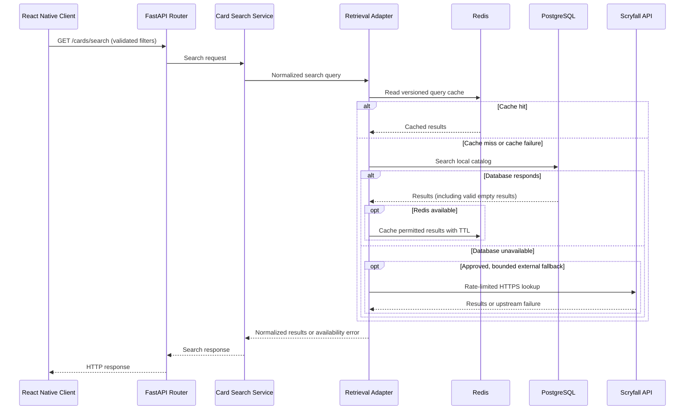
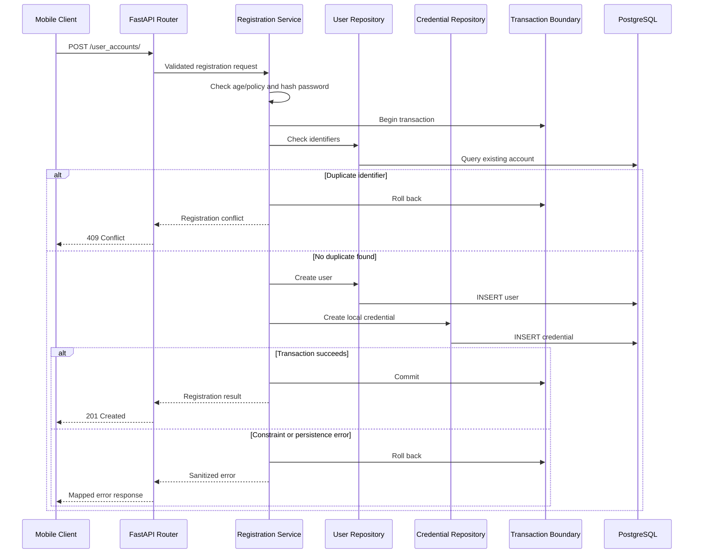
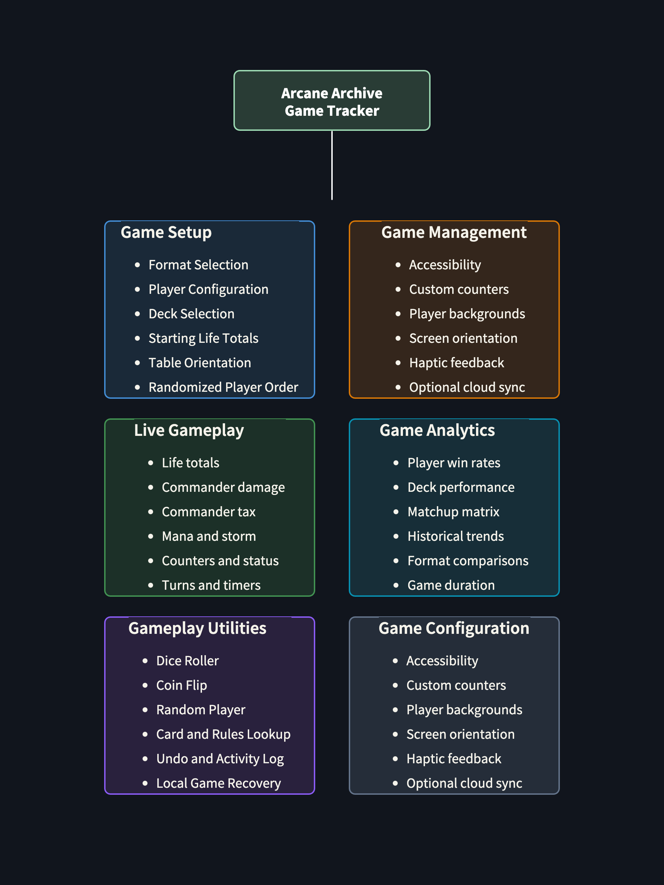

# System Architecture and Design

### Arcane Archive – Backend Architecture

**Document Status: Draft**

**Revision: 2026-11-18**

## Purpose & Scope
This document describes the system architecture, design, decisions, components, data model, security requirements, 
deployment topology, operation requirements, and integration of the Arcane Archive backend. Arcane Archive is a 
Magic: The Gathering companion application with a React Native, Expo, TypeScript, with a FastAPI REST API. 

The backend supports the following features:

1. Public card and set data retrieval.
2. User authentication and authorization.
3. User profile management.
4. Card library management.
5. Wishlist management.
6. Deck building and management.
7. Game tracking.
8. Integration with Scryfall API for card data and images.
9. Mobile-friendly design.
10. AI-assisted deck building (planned for future implementation).

See [Overview & Installation](/docs/overview-and-installation.md) for more information on how to install and run the 
backend.

## Features 

| Feature                             | Scope                                                        |
|-------------------------------------|--------------------------------------------------------------|
| FastAPI Backend                     | HTTP routers, pydantic schemas, database models              |
| Local user authentication           | JWT-based authentication with password hashing and salting   |
| Firebase social authentication      | OAuth2-based authentication with Google, Facebook, and Apple |
| Simple & Advanced Search            | Search for cards by name, set, or other criteria             |
| Scryfall API Integration            | Bulk downloads, normalization, and database upserts          |
| Player Profile Management           | User profile management, preferences, and game stats         |
| Card Library Management             | Manage card collections, wishlists, and sets                 |
| Wishlist Management                 | Create, edit, and delete wishlists                           |
| Deck Builder                        | Create, edit, and manage decks                               |
| Card Scanner                        | Scan cards to add to the user's library                      |
| Redis Caching                       | Cache-aside for public card data                             |
| pgVector & AI Deck Builder (Future) | Store AI-generated card embeddings for semantic search       |
| pgBouncer & pgBackRest              | Connection pooling and backup/recovery for PostgreSQL        |

## System Architecture

Arcane Archive is designed to be maintainable, scalable, testable, and reliable. Its backend architecture combines 
SOLID principles, a layered architecture, the repository pattern, transaction management, the adaptor pattern, and 
dependency injection within a modular monolith. 

### C4 Level 1 Context View



### C4 Level 2 Container View


### C4 Level 3 Component View



### Architectural Layers

1. **Presentation Layer**: FastAPI routers, Pydantic, Request/Response schemas. 
2. **Application Layer**: Register user, save deck, search cards. 
3. **Domain Layer**: Card quantity, deck format, ownership. 
4. **Data Access Layer**: User, credentials, card, and deck repositories. 
5. **Infrastructure Layer**: SQLAlchemy, Redis, Firebase Admin SDK, Scryfall API, pgBouncer, pgBackRest.

### SOLID Principles

- **Single Responsibility Principle** – Each module or class should have one reason to change. 
- **Open/Closed Principle** – The application is open for extension but closed for modification allowing for future 
  enhancements like adding an AI Deck Service.  
- **Liskov Substitution Principle** – Example: Different auth methods (local and Firebase social auth) can both be used 
  interchangeably with the token schema without affecting the application's behavior.
- **Interface Segregation Principle** – Instead of one giant repository, I have separated the repositories into smaller, 
  more focused components to only pull in the data they need.
- **Dependency Inversion Principle** – Services don't create their own database connections but instead ask for them 
  through the dependencies they need.

### Architectural Styles & Design Patterns

| Category                | Selected Pattern                                | 
|-------------------------|-------------------------------------------------|
| Architectural Style     | **Modular Monolith**                            |
| Architectural Pattern   | **Layered Architecture**                        |
| Design Principle        | **Separation of Concerns**                      |
| Persistence Pattern     | **Repository Pattern & Transaction Management** |
| Composition Pattern     | **Dependency Injection**                        |
| Integration Pattern     | **Adapter Pattern**                             |
| Caching Pattern         | **Cache-Aside**                                 |
| Data Processing Pattern | **ETL Pipeline (Extract, Transform, Load)**     | 
| Resilience Approach     | **Graceful Degradation**                        |

See [References](#references) for more information on the design patterns I used in this project.

### Alternatives Considered

**Microservices Architecture**

I considered using a microservices architecture for this project, but I decided against it for several reasons:

- A microservices architecture would add complexity to the application. I found that a modular monolith 
  is simpler to develop, test, and deploy, debug, and maintain. It also allows me to focus on the core functionality of 
  the application while maintaining separation of concerns.
- With microservices latency and network communication could potentially introduce performance 
  issues. A modular monolith fits better for Arcane Archive's current requirements, as it eliminates network
  overhead and allows for faster communication between components.
- Using a modular monolith allows me to deploy the application as a single unit, which is simpler 
  and easier to manage.
- Microservices can provide better scalability, but I found that a modular monolith can still be 
  scaled horizontally by adding more instances of the application. This is enough to satisfy the current requirements 
  of Arcane Archive.  If the application grows in complexity and requires more scalability, I can refactor the 
  application into a microservices architecture in the future.

**Decision**: I selected a modular monolith because it fits best with the current project requirements, while still 
allowing me to scale the application in the future if needed. It also provides a balanced approach for maintainability, 
testability, and performance.

**Routes accessing the database directly**

I considered having the API routes access the database directly, but I decided against it for several reasons:

- I would be mixing concerns between the API layer and the data access layer. This would make the code harder to 
  maintain and test.
- It would be harder to test the application. 
  By using a service layer, I can easily mock the service layer for testing without needing to access the database.
- It would be harder to change the data access layer in the future without affecting the API layer. By using a service 
  layer, I can easily change the data access layer without affecting the API layer.
- It would be duplicating code across multiple routes. By using a service layer, I can reuse the same service methods 
  across multiple routes, reducing code duplication and improving maintainability.
- I would be exposing the database to potential security vulnerabilities. By using a service layer, I can implement 
  security measures such as input validation and authentication in a centralized location, reducing the risk of 
  security vulnerabilities.
- I would be making the code harder to maintain. 

**Decision**: I selected a layered architecture with application services because it provides a clean separation of 
concerns between the API layer and the data access layer, while still allowing me to easily test, maintain, scale, 
and secure the application. It also allows me to reuse code across multiple routes, reducing code duplication and 
improving maintainability.

### Ownership & Responsibility

1. Scryfall & Wizards of the Coast own the card data and images. Arcane Archive stores the data in a PostgreSQL 
   database.
2. Arcane Archive owns the user data and authentication as well as accounts, collections, wishlists, saved decks, 
   and game stats.
3. PostgreSQL is the normal local read source.
4. Wizards of the Coast owns the artwork and MTG intellectual property.
5. Users own their personal data and are responsible for managing their account information and privacy settings.
6. Redis is a non-authoritative cache.

## Domain Model & Database Design

The following ERD shows a draft of the database design for Arcane Archive. 



### Card ID and Deck Validation

Scryfall identifies cards by their unique Scryfall ID and sometimes an Oracle ID. An Oracle ID is a unique identifier 
for a card that is used to group all printings of a card together. A card can have multiple printings, and each printing 
can have different editions, languages, finishes, or conditions, etc. Collections refer to printings because players care 
about the cards they have in their collection, not the specific edition or language. Some cards may lack an Oracle ID, 
but they still have a unique Scryfall ID. 

### Card Data Ingestion

The target for Arcane Archive is to ingest Scryfall's bulk data file containing 52,000+ cards. This will allow me to 
have a high-performance application that will remain sustainable at zero cost. A daily import of the bulk data file 
will take place to provide the most up-to-date card data.

**Card Ingestion Process**:
1. Retrieve and Download the bulk data file from Scryfall's API.
2. Validate and normalize the data while preserving Scryfall's identifiers.
3. Upsert the data into the PostgreSQL database, ensuring that existing records are updated and new records are 
   inserted.
4. Publish the updated card data to the Redis cache for real-time updates.
5. Record the latest version, import time, record counts, duration, rejected records, and outcome.
6. Retain the last successful catalog on download, validation, or import failure and alert on staleness.

See [Scryfall Bulk Data](https://scryfall.com/docs/api/bulk-data) and 
[API Usage Guide](https://scryfall.com/docs/syntax) for more information on the bulk data file format.

## Local-First Card Retrieval & Failure Handling

Card search uses Redis as a cache-aside for public card data. The application will first attempt to retrieve the 
catalog from Redis. If the Redis cache is unavailable, the application will attempt to retrieve the catalog from the
local catalog. If the local catalog is unavailable, the application will attempt to retrieve the catalog from 
Scryfall's API.



### User Registration Flow



### Game Tracker 

The proposed game tracking design keeps track of mana, life, commander tax, damage, and counters, etc. on the mobile 
client. 

**Live Game Play**: Fast, real-time updates of game state. 

**Game History**: Saved games, deck performance, player statistics, game outcomes, historical trends, etc.



### Card Scanner

The card scanner feature allows users to scan a card from their camera and add it to their collection.

## Data Storage & Retrieval
### SQL Vs. NoSQL Database
I chose to use a PostgreSQL Database for this project because it provides a robust and reliable way to store and 
retrieve data. PostgreSQL is well-suited for complex queries and transactions, which are essential for handling user 
collections, wishlists, and other features of the Arcane Archive application. Additionally, PostgreSQL provides ACID 
compliance, which guarantees data consistency and reliability. By choosing PostgreSQL, I also gain access to the 
pgvector extension. This will allow me to store AI-generated card embeddings for semantic search, which enables the 
AI Deck Builder to find cards based on their 'feel' or 'strategy' rather than just keywords.

### Scryfall Data Usage and Rate Limiting
To adhere to Scryfall's API usage policies, I will implement a 100 ms rate limit for all calls to api.scryfall.com to 
avoid 429 errors. For image assets, I will use a Bulk-to-CDN path: the app extracts image URIs from the locally 
processed bulk JSON file and fetches the assets from the .scryfall.io domain. Because the image CDN is decoupled from 
the primary API rate limits (scryfall.io doesn't require a rate limit), this allows the app to lazily cache 
high-resolution card art to OCI Object Storage without risking an API ban. 

### Hotlinking Vs. Object Storage
To avoid hotlinking issues, I chose to use OCI Object Storage to store card images. Images that are not
used are not directly linked from Scryfall's servers, reducing the risk of being blocked by Scryfall's rate limits or
other policies.

I will implement this lazy loading strategy where the application first checks the OCI Object Storage for the 
card image, and if the card is not found, it fetches the card image from Scryfall's CDN. This ensures that the 
application does not exceed the rate limit on api.scryfall.com and minimizes API calls.

### AsyncSession for Database Transactions
I chose to use AsyncSession for database transactions because it allows multiple concurrent database transactions 
without blocking other transactions, improving performance and scalability.

## Performance & Resource Management

### Connection Pooling with pgBouncer
I chose to use pgBouncer for connection pooling, a cache of database connections that can be reused for multiple 
client requests to improve performance and reduce the number of database connections. This will also help to prevent 
connection overload and provide efficient resource utilization. This would allow hundreds of concurrent mobile 
sessions with only a small number of database connections.

This will significantly reduce the overhead on the 24GBs RAM allowance with Oracle Cloud and prevent 
"too many connections" errors, which are commonly encountered with high-traffic MTG searches.

### In-memory Caching with Redis
I chose to use Redis for in-memory caching to reduce latency and improve performance for frequently accessed data 
like search results and card data.

## Data Reliability & Disaster Recovery

### Data Backup and Recovery with pgBackRest
I chose to use pgBackRest for data backup and recovery. The data will be backed up regularly and can be restored 
in case of a disaster or data loss. pgBackRest provides Point-in-Time Recovery, allowing me to recover the database to 
the specific second if a data corruption event occurs.

### CAP: Consistency & Partition Tolerance 
I chose to prioritize consistency and partition tolerance because I would rather reject a collection update temporarily
than show an incorrect result to the user. I want users to be able to add or remove cards from their collection and 
return an unstandable error message instead of losing or duplicating a user's data.

### Data Integrity via Schemas
I chose to use Pydantic schemas for data validation and normalization. This ensures that data is consistent and reliable  
and helps to prevent errors and inconsistencies in the database. This also ensures that sensitive database information 
is protected and is never exposed to the outside world.

### Dependency Management and Virtual Environment
I decided to use Poetry for dependency management and virtual environment management mainly for its ease of use
and flexibility. By using Poetry, I can easily manage dependencies and virtual environments for my project. Using 
Poetry's lockfile also allows for consistent and reliable dependencies across different environments.

## Scalability 
To ensure the Arcane Archive can handle an increased load and traffic, the following scalability strategies are 
applied:

1. In-memory caching with Redis for caching search results and card data to reduce latency and improve performance.
2. Load balancing to distribute incoming traffic across multiple server instances.
3. Database optimization with indexing and read replicas to enhance query performance and handle an increased load.
4. Containerization with Docker for consistent deployment across different environments.
5. Horizontal scaling by adding more instances of the application server as demand increases.

### Dependency Injection

I designed Arcane Archive to be flexible and modular by using dependency injection. This allows me to replace real
dependencies with mocks during testing and makes the code more testable, maintainable, and scalable. The following 
diagram illustrates the dependency injection flow for a request:



Arcane Archive uses the dependency injection framework [dependency-injector](https://python-dependency-injector.ets-labs.org/index.html) 
to manage the dependencies of the application.

## License and Attribution

Arcane Archive is documented as an MIT-licensed project.

Magic: The Gathering and associated intellectual property are owned by[Wizards of the Coast LLC](https://company.wizards.com/en/legal/intellectualproperty). Arcane Archive 
is an unofficial fan project and is not approved or endorsed by Wizards of the Coast. Use of MTG materials is subject 
to the [Wizards of the Coast Fan Content Policy](https://company.wizards.com/en/legal/fancontentpolicy).

Card information and images are sourced through [Scryfall](https://scryfall.com). Scryfall is a third-party service and
does not endorse Arcane Archive. Integrations and displayed content are subject to applicable Scryfall usage and 
attribution requirements.

## Technology Stack

| Layer                | Technology                            |
|----------------------|---------------------------------------|
| Framework            | FastAPI                               |
| Server               | Uvicorn                               |
| Database             | PostgreSQL (Oracle Cloud)             |
| ORM                  | SQLAlchemy 2.0                        |
| Migrations           | Alembic                               |
| Validation           | Pydantic v2                           |
| Dependency Injection | FastAPI Depends + dependency-injector |
| Authentication       | JWT (python-jose), Firebase Admin SDK |
| External APIs        | Scryfall API                          |
| Testing              | pytest, pytest-asyncio                |
| Package Manager      | Poetry                                |

## Project Structure

```
arcane-archive-backend/
├── main.py                    
├── database.py                
├── container.py           
├── firebase_config.py       
├── common/
│   ├── base.py              
│   ├── config.py            
│   ├── repository.py        
│   └── dependencies.py      
├── models/                  
│   └── cards.py
├── schemas/                 
│   └── cards_schema.py
├── repositories/            
│   └── card_repository.py
├── routers/                
│   └── scryfall_advanced_card_search_router.py
├── authentication/
│   ├── models/            
│   ├── repositories/      
│   ├── routers/          
│   ├── schemas/          
│   ├── services/          
│   └── security.py       
├── alembic/                
├── tests/                  
└── pyproject.toml          
```

## Security Considerations

- **Password Hashing**: Uses bcrypt via `passlib`
- **JWT Tokens**: Token-based authentication with expiration
- **Firebase Auth**: External authentication provider integration
- **CORS**: Configured for specific frontend origins only
- **Input Validation**: Pydantic models validate all inputs

# References

[1] [Scryfall API Documentation](./docs/scryfall_api_docs.md)

[2] [Scryfall Bulk Data](https://scryfall.com/docs/api/bulk-data)

[3] [Scryfall API Rate Limits](https://scryfall.com/docs/api/rate-limits)

[4] [Scryfall API Terms of Service](https://scryfall.com/docs/api/terms-of-service)

[5] [SOLID Principles](https://www.educative.io/courses/grokking-nodejs-design-patterns-interview/the-solid-principles?utm_term=&utm_campaign=%5BNew+-+Mar+24%5D+Brand+Core+Performance+Max&utm_source=adwords&utm_medium=ppc&hsa_acc=5451446008&hsa_cam=21099703438&hsa_grp=&hsa_ad=&hsa_src=x&hsa_tgt=&hsa_kw=&hsa_mt=&hsa_net=adwords&hsa_ver=3&gad_source=1&gad_campaignid=21089679273&gbraid=0AAAAADfWLuTbsmqmcbl__NU46v6gbqzBt&gclid=Cj0KCQiAwdDXBhDuARIsAFdLukmnOU6EwFDIUf2sLaYWhCMsrXM_vLegr8qrXQBJ5aE1k0uRwAqywrEaAgZnEALw_wcB)

[6] [Repository Pattern](https://www.educative.io/courses/grokking-nodejs-design-patterns-interview/the-repository-pattern?utm_term=&utm_campaign=%5BNew+-+Mar+24%5D+Brand+Core+Performance+Max&utm_source=adwords&utm_medium=ppc&hsa_acc=5451446008&hsa_cam=21099703438&hsa_grp=&hsa_ad=&hsa_src=x&hsa_tgt=&hsa_kw=&hsa_mt=&hsa_net=adwords&hsa_ver=3&gad_source=1&gad_campaignid=21089679273&gbraid=0AAAAADfWLuTbsmqmcbl__NU46v6gbqzBt&gclid=Cj0KCQiAwdDXBhDuARIsAFdLukmnOU6EwFDIUf2sLaYWhCMsrXM_vLegr8qrXQBJ5aE1k0uRwAqywrEaAgZnEALw_wcB)

[7] [SOLID - The first five principles of Object-Oriented Design](https://www.digitalocean.com/community/conceptual-articles/s-o-l-i-d-the-first-five-principles-of-object-oriented-design)

[8] [Wizards of the Coast Fan Content Policy](https://company.wizards.com/en/legal/fancontentpolicy)

[9] [Wizards of the Coast Intellectual Property](https://company.wizards.com/en/legal/intellectualproperty)

[10] [Modular Monolith](https://www.dandoescode.com/blog/modular-monolith/a-gentle-introduction)

[11] [Transaction Management with SQLAlchemy](https://docs.sqlalchemy.org/en/20/orm/session_transaction.html)

[12] [Dependency Injection in FastAPI](https://fastapi.tiangolo.com/tutorial/dependencies/)

[13] [pgBouncer](https://www.pgbouncer.org/)

[14] [pgVector](https://github.com/pgvector/pgvector)

[15] [pgBackrest](https://pgbackrest.org/)

[16] [Redis](https://redis.io/)

[17] [Redis Cache Aside](https://redis.io/tutorials/howtos/solutions/microservices/caching/)

[18] [OCI Object Storage](https://docs.oracle.com/en-us/iaas/Content/Object/Concepts/objectstorageoverview.htm)

[19] [pgBackrest - User Guide](https://pgbackrest.org/user-guide.html)

[20] [Python Dependency Injection](https://www.datacamp.com/tutorial/python-dependency-injection?utm_cid=23487274749&utm_aid=192541861336&utm_campaign=230119_1-ps-dscia~dsa-tofu~python_2-b2c_3-nam_4-prc_5-na_6-na_7-le_8-pdsh-go_9-nb-e_10-na_11-na&utm_loc=9212987-&utm_mtd=-c&utm_kw=&utm_source=google&utm_medium=paid_search&utm_content=ps-dscia~nam-en~dsa~tofu~tutorial~python&gad_source=1&gad_campaignid=23487274749&gbraid=0AAAAADQ9WsG8Irf9IF3Fl-xONPg5v2q9R&gclid=Cj0KCQiAtvXXBhC2ARIsAJc8SUTFU9381sm4khnbTTf9A-CMHb94Wp-dqq-iJlksGlTgXn7uRUwjY58aAo6xEALw_wcB)

[21][Dependency Injection and Inversion of Control](https://python-dependency-injector.ets-labs.org/introduction/di_in_python.html)

