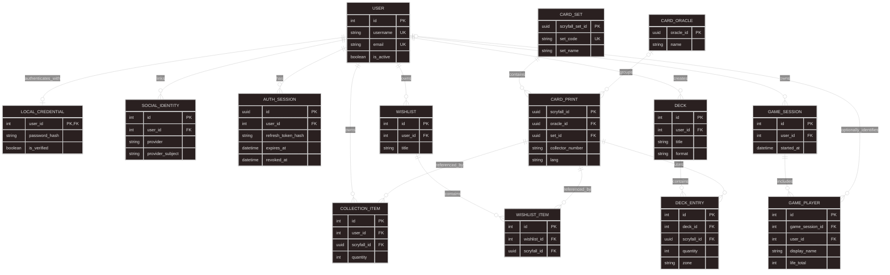
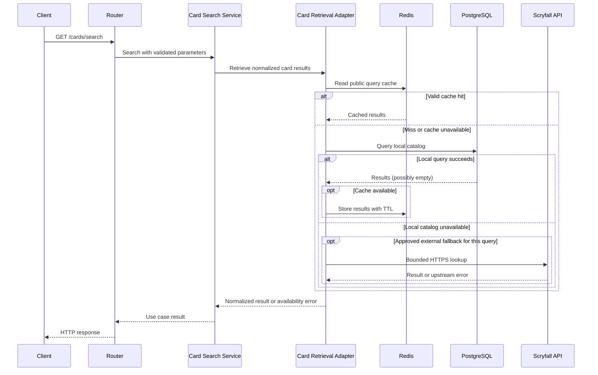
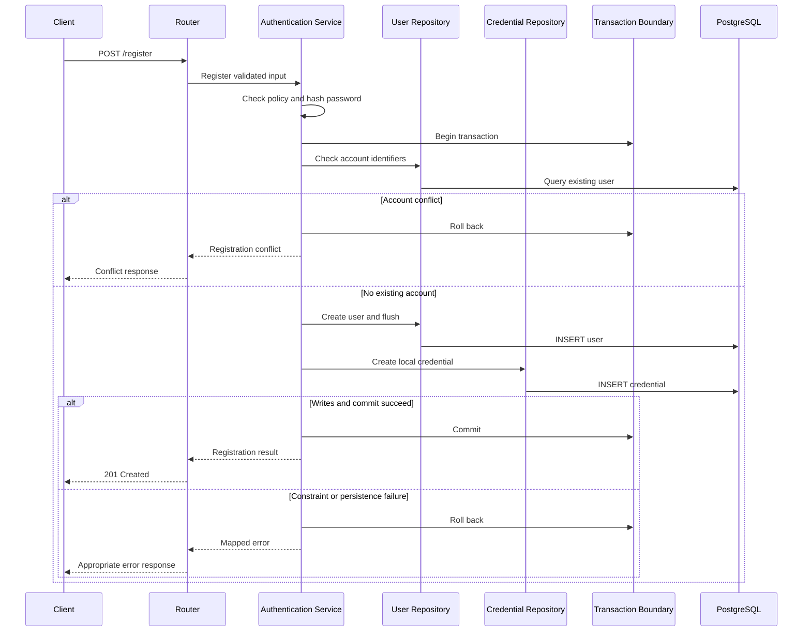
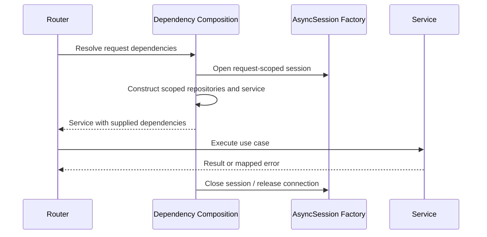

# System Architecture and Design

## Arcane Archive Backend

## Purpose & Scope
This document describes the system architecture and design of the Arcane Archive backend, a FastAPI REST API for 
the Arcane Archive MTG companion application.

See [Overview & Installation](/docs/overview-and-installation.md) for more information on how to install and run the 
backend.

## Summary
Arcane Archive is a Magic: The Gathering(MTG) companion app. It is a user-friendly mobile application that is designed 
to enhance an MTG player's experience that helps users manage their card collections, create wishlists, build decks, and 
track their games.  In addition to these features, an AI Deck Builder is planned for future implementation.

The backend uses PostgreSQL to persist card data and user information. Scryfall API is integrated to provide card 
information and images by using the bulk data download feature. An AI-assisted deck builder is planned for future
implementation.

## Objectives

- Library Management: Provide a card library so users can manage card collections, including library 
  organization, wish lists, card collections, and set management.
- Card Search: Offer both an advanced and simple user-friendly search feature that allows users to easily find specific 
  cards or sets. 
- Game Tracker: Include essential game tools such as a multi-player game tracker that tracks a player’s name, damage, tax,
  mana count, counters, life counter, and other game stats.
- Deck Builder: Provide a comprehensive deck building feature with the ability to save the deck to a user’s library.
- User Accounts: Support private user accounts, profiles, collections, wishlists, and saved decks.
- Card Scanner: Provide a card scanner to easily add cards to a user’s library.
- Mobile Support: Support mobile devices and platforms with user-friendly design.
- Reliable Card Data: Integrate Scryfall API reference data through controlled API access and bulk data ingestion.

## Overview
Arcane Archive is a mobile application for Magic: The Gathering players, built with React Native, TypeScript, Expo, and 
FastAPI. Players can create a profile where their game stats, card library, wish lists, and other preferences are stored. 
Arcane Archive offers an advanced and simple search feature, a deck builder, user profile, card library, card scanner, 
and the ability to create wishlists. The app also includes a multi-player game tracker that tracks a player’s name, 
damage, tax, mana count, counters, a life counter, and other stats. Integrated with Scryfall API, Arcane Archive 
provides daily updates to the most current card data.

## Features 

| Feature                             | Scope                                                        |
|-------------------------------------|--------------------------------------------------------------|
| FastAPI Backend                     | HTTP routers, pydantic schemas, database models              |
| Local user authentication           | JWT-based authentication with password hashing and salting   |
| Firebase social authentication      | OAuth2-based authentication with Google, Facebook, and Apple |
| Simple & Advanced Search            | Search for cards by name, set, or other criteria             |
| Scryfall API Integration            | Bulk downloads, normalization, and database upserts          |
| Player Profile Management           | User profile management, preferences, and game stats         |
| Card Library Management             | Manage card collections, wishlists, and sets                 |
| Wishlist Management                 | Create, edit, and delete wishlists                           |
| Deck Builder                        | Create, edit, and manage decks                               |
| Card Scanner                        | Scan cards to add to the user's library                      |
| Redis Caching                       | Cache-aside for public card data                             |
| pgVector & AI Deck Builder (Future) | Store AI-generated card embeddings for semantic search       |
| pgBouncer & pgBackRest              | Connection pooling and backup/recovery for PostgreSQL        |

## System Architecture

Arcane Archive is designed to be maintainable, scalable, testable, and reliable. Its backend architecture combines 
SOLID principles, a layered architecture, the repository pattern, and dependency injection within a modular monolith. 

### C4 Level 1 Context View


### C4 Level 2 Container View



### C4 Level 3 Component View


### SOLID Principles

- **Single Responsibility Principle** – Each file has one job (e.g., user_repository only talks to the database).
- **Open/Closed Principle** – The application is open for extension but closed for modification allowing for future 
  enhancements like adding an AI Deck Service.  
- **Liskov Substitution Principle** – Example: Different auth methods (local and Firebase social auth) can both be used 
  interchangeably with the token schema without affecting the application's behavior.
- **Interface Segregation Principle** – Instead of one giant repository, I have separated the repositories into smaller, 
  more focused components to only pull in the data they need.
- **Dependency Inversion Principle** – Services don't create their own database connections but instead ask for them 
  through the dependencies they need.  

### Architectural Design Patterns

- **Modular Monolith** - Arcane Archive is designed as a modular monolith, which allows for a single deployment
  while maintaining a modular structure. This allows for easier maintenance, testing, and deployment while still 
  allowing for future scalability and flexibility.  
- **Separation of Concerns & Layered Architecture** – Responsibilities are separated across different layers where each 
  layer handles a specific aspect of the application (e.g., service layer, repository layer, and API layer).
- **Repository Pattern** – Arcane Archive uses a repository pattern to abstract the data access layer from the 
  business logic layer. This provides abstraction and decoupling between application services and database queries.
- **Transaction Management**: Arcane Archive uses SQLAlchemy's AsyncSession to manage database transactions. 
  SQLAlchemy's Unit of Work pattern is used so that repositories never commit transactions directly.
- **Dependency Injection** – Arcane Archive uses FastAPI's built-in dependency injection to manage dependencies 
  and promote loose coupling between components. 
- **Cache-Aside**: Read from the cache when available, on a miss, read the database, and update the cache.

See [References](#references) for more information on the design patterns I used in this project.

### Alternatives Considered

**Microservices Architecture**

I considered using a microservices architecture for this project, but I decided against it for several reasons:

- **Complexity**: A microservices architecture would add complexity to the application. I found that a modular monolith 
  is simpler to develop, test, and deploy, debug, and maintain. It also allows me to focus on the core functionality of 
  the application while maintaining separation of concerns.
- **Performance**: With microservices latency and network communication could potentially introduce performance 
  issues. A modular monolith fits better for Arcane Archive's current requirements, as it eliminates network
  overhead and allows for faster communication between components.
- **Deployment**: Using a modular monolith allows me to deploy the application as a single unit, which is simpler 
  and easier to manage.
- **Scalability**: Microservices can provide better scalability, but I found that a modular monolith can still be 
  scaled horizontally by adding more instances of the application. This is enough to satisfy the current requirements 
  of Arcane Archive.  If the application grows in complexity and requires more scalability, I can refactor the 
  application into a microservices architecture in the future.

**Decision**: I selected a modular monolith because it fits best with the current project requirements, while still 
allowing me to scale the application in the future if needed. It also provides a balanced approach for maintainability, 
testability, and performance.

**Routes accessing the database directly**

I considered having the API routes access the database directly, but I decided against it for several reasons:

- **Separation of Concerns**: By having the API routes access the database directly, I would be mixing concerns 
  between the API layer and the data access layer. This would make the code harder to maintain and test.
- **Testability**: By having the API routes access the database directly, it would be harder to test the application. 
  By using a service layer, I can easily mock the service layer for testing without needing to access the database.
- **Flexibility**: By having the API routes access the database directly, I would be tightly coupling the API layer 
  to the data access layer. This would make it harder to change the data access layer in the future without affecting 
  the API layer. By using a service layer, I can easily change the data access layer without affecting the API layer.
- **Reusability**: By having the API routes access the database directly, I would be duplicating code across multiple 
  routes. By using a service layer, I can reuse the same service methods across multiple routes, reducing code duplication 
  and improving maintainability.
- **Security**: By having the API routes access the database directly, I would be exposing the database to potential 
  security vulnerabilities. By using a service layer, I can implement security measures such as input validation and 
  authentication in a centralized location, reducing the risk of security vulnerabilities.
- **Maintainability**: By having the API routes access the database directly, I would be making the code harder to 
  maintain. 

**Decision**: I selected a layered architecture with application services because it provides a clean separation of 
concerns between the API layer and the data access layer, while still allowing me to easily test, maintain, scale, 
and secure the application. It also allows me to reuse code across multiple routes, reducing code duplication and 
improving maintainability.

### Ownership & Responsibility

1. Scryfall owns the card data and images. Arcane Archive stores the data in a PostgreSQL database.
2. Arcane Archive owns the user data and authentication as well as accounts, collections, wishlists, saved decks, 
   and game stats.
3. Users own their personal data and are responsible for managing their account information and privacy settings.
4. Redis is a non-authoritative cache and entries may expire.

## Domain Model & Database Design

The following ERD shows the database design for the Arcane Archive backend. 



### Card Data Ingestion

The target for Arcane Archive is to ingest Scryfall's bulk data file containing 52,000+ cards. This will allow me to 
have a high-performance application that will remain sustainable at zero cost. A daily import of the bulk data file 
will take place to provide the most up-to-date card data.

**Card Ingestion Process**:
1. Retrieve and Download the bulk data file from Scryfall's API.
2. Validate and normalize the data, while preserving Scryfall's identifiers.
3. Upsert the data into the PostgreSQL database, ensuring that existing records are updated and new records are 
   inserted.
4. Publish the updated card data to the Redis cache for real-time updates.
5. Record the latest version, import time, record counts, duration, rejected records, and outcome.
6. Retain the last successful catalog on download, validation, or import failure and alert on staleness.

See [Scryfall Bulk Data](https://scryfall.com/docs/api/bulk-data) and [API Usage Guide](https://scryfall.com/docs/syntax) 
for more information on the bulk data file format.

### Local-First Card Retrieval & Failure Handling

Card search uses Redis as a cache-aside for public card data. The application will first attempt to retrieve the 
catalog from Redis. If the Redis cache is unavailable, the application will attempt to retrieve the catalog from the
local catalog. If the local catalog is unavailable, the application will attempt to retrieve the catalog from 
Scryfall's API.



### User Registration Flow


### Cloud Infrastructure Selection
I selected Oracle Cloud Infrastructure (OCI) for this project primarily due to its always free tier which allows for 
cost efficiency without sacrificing performance.  Their Ampere A1 compute shapes provide a high memory capacity of 24GBs, 
which is required to host the application, a PostgreSQL database, and a Redis Cache in a single instance. The free tier will also 
be enough for the data ingestion of Scryfall's bulk data file containing 52,000+ cards. This allows me to have a 
high-performance application that will remain sustainable at zero cost.

### DMZ & Network Architecture
I implemented a DMZ(Demilitarized Zone) to separate the public-facing services from the internal services. 
This provides an additional layer of security and helps to prevent unauthorized access to sensitive data like user credentials.
I did this using OCI's Virtual Cloud Network (VCN). By placing the API and Database in a private subnet and only exposing 
the load balancer to the public, I ensure that user data remains unaccessible from the public internet.

I implemented several security measures to protect user data and ensure the integrity of the application. 
These include using HTTPS for all API requests and implementing JWT authentication for secure user sessions. 
Additionally, I use dependency injection for testability and loose coupling, which helps to prevent injection attacks.

I used NGINX as a reverse proxy to handle the incoming requests.  This is the entry point within the DMZ which ensures 
that all incoming requests are authenticated and encrypted before reaching the API.

I used the OCI Service Gateway to ensure that the API can securely communicate with OCI Object Storage
for card image storage and retrieval. This allows the private subnet to securely access OCI Object Storage without exposing 
it to the public internet.

I used OCI Logging and Monitoring to ensure that the application is monitored and that any errors are 
detected and addressed as soon as possible. This also provides me with visibility of the Docker stack to manage the
24GBs of RAM for the Oracle Cloud infrastructure efficiently.

## Data Storage & Retrieval
### SQL Vs. NoSQL Database
I chose to use a PostgreSQL Database for this project because it provides a robust and reliable way to store and retrieve data. 
PostgreSQL is well-suited for complex queries and transactions, which are essential for handling user collections, 
wishlists, and other features of the Arcane Archive application. Additionally, PostgreSQL provides ACID compliance, 
which ensures data consistency and reliability. By choosing PostgreSQL, I also gain access to the pgvector extension. 
This will allow me to store AI-generated card embeddings for semantic search, which enables the AI Deck Builder to 
find cards based on their 'feel' or 'strategy' rather than just keywords.

### PostgreSQL with pgVector
I chose PostgreSQL for its ACID compliance and robustness in handling complex queries for user collections. By using 
pgVector, I can store AI-generated card embeddings. This enables a semantic search feature allowing the AI Deck Builder 
to find cards based on strategic feel, like aggressive, defensive, or control, rather than just keyword matching.

### Dual-Path Data Ingestion with Scryfall API & Bulk Data File
I chose to use Scryfall's API for real-time card data updates and to adhere to their API usage policies. 
However, for bulk data ingestion, I use Scryfall's bulk data file to ensure data consistency and to avoid hitting the API rate limit. 
This approach allows for a balance between real-time updates and efficient data ingestion.

### Scryfall Data Usage and Rate Limiting
To adhere to Scryfall's API usage policies, I implemented a 100ms rate limit for all calls to api.scryfall.com to avoid 429 errors. 
For image assets, I used a Bulk-to-CDN path: the app extracts image URIs from the locally processed bulk JSON file 
and fetches the assets from the .scryfall.io domain. Because the image CDN is decoupled from the primary API rate limits
(scryfall.io doesn't require a rate limit), this allows the app to lazily cache high-resolution card art to OCI Object Storage without risking an API ban. 

### Hotlinking Vs. Object Storage
To avoid hotlinking issues, I chose to use OCI Object Storage to store card images. Images that are not
used are not directly linked from Scryfall's servers, reducing the risk of being blocked by Scryfall's rate limits or \
other policies.

Because the image CDN is decoupled from the primary API rate limits on Scryfall's API (scryfall.io doesn't require a 
rate limit), this allows the app to lazily cache high-resolution card art to OCI Object Storage without risking an API
ban.

I will implement this lazy loading strategy where the application first checks the OCI Object Storage for the card image, 
and if the card is not found, it fetches the card image from Scryfall's CDN. This ensures that the application 
does not exceed the rate limit on api.scryfall.com and minimizes API calls.

### AsyncSession for Database Transactions
I chose to use AsyncSession for database transactions because it allows multiple concurrent database transactions 
without blocking other transactions, improving performance and scalability. 

### Dependency Injection for Testability
I chose to use FastAPI's Dependency Injection for testability. This allows for easy mocking of repositories during testing, 
which high code coverage without needing a live database connection. Dependency Injection also provides loose coupling 
and makes the codebase more testable, maintainable, and scalable.

## Performance & Resource Management
### Connection Pooling with pgBouncer
I chose to use pgBouncer for connection pooling, a cache of database connections that can be reused for multiple client requests
to improve performance and reduce the number of database connections. This also helps to prevent connection overload and 
ensures efficient resource utilization. This would allow hundreds of concurrent mobile sessions with only a small number of database connections.*

This will significantly reduce the overhead on the 24GBs RAM allowance with Oracle Cloud and prevents 
"too many connections" errors, which are commonly encountered with high-traffic MTG searches.

### In-memory Caching with Redis
I chose to use Redis for in-memory caching to reduce latency and improve performance for frequently accessed data like search results and card data.*

## Data Reliability & Disaster Recovery
### Data Backup and Recovery with pgBackRest
I chose to use pgBackRest for data backup and recovery. This ensures that data is backed up regularly and can be restored 
in case of a disaster or data loss. pgBackRest provides Point-in-Time Recovery, allowing me 
to recover the database to a specific second if a data corruption event occurs.

### CAP: Consistency & Partition Tolerance 
I chose to prioritize Consistency and Partition Tolerance for this project. This is because the Arcane Archive application 
requires data consistency and reliability for user collections, wishlists, and other features. Consistency ensures that 
data is accurate and up to date, while Partition Tolerance allows the application to continue functioning even if some 
parts of the system fail. Users expect their data to be accurate and reliable, and this approach ensures that the application 
meets those expectations. A user would rather hit retry than see incorrect or incomplete data (e.g., missing cards in 
their collection or incomplete deck creation).

### Data Integrity via Schemas
I chose to use Pydantic schemas for data validation and normalization. This ensures that data is consistent and reliable  
and helps to prevent errors and inconsistencies in the database. This also ensures that sensitive database information is 
protected and is never exposed to the outside world.

### Dependency Management and Virtual Environment
I decided to use Poetry for dependency management and virtual environment management mainly for its ease of use
and flexibility. By using Poetry, I can easily manage dependencies and virtual environments for my project, 
ensuring a consistent and reproducible development environment. Using Poetry's lockfile also ensures deterministic builds, 
allowing for consistent and reliable dependencies across different environments (e.g., development, testing, and production).
This effectively eliminates "It works on my machine" bugs.

## Scalability 
To ensure the Arcane Archive backend can handle an increased load and traffic, the following scalability strategies are 
applied:

1. In-memory caching with Redis for caching search results and card data to reduce latency and improve performance.
2. Load balancing to distribute incoming traffic across multiple server instances.
3. Database optimization with indexing and read replicas to enhance query performance and handle an increased load.
4. Asynchronous task processing with Celery and RabbitMQ for handling background tasks like card data updates.
5. Containerization with Docker for consistent deployment across different environments.
6. Horizontal scaling by adding more instances of the application server as demand increases.

### Dependency Injection


## License and Attribution

Arcane Archive is documented as an MIT-licensed project.

Magic: The Gathering and associated intellectual property are owned by 
[Wizards of the Coast LLC](https://company.wizards.com/en/legal/intellectualproperty). Arcane Archive is an 
unofficial fan project and is not approved or endorsed by Wizards of the Coast. Use of MTG materials is subject to the 
[Wizards of the Coast Fan Content Policy](https://company.wizards.com/en/legal/fancontentpolicy).

Card information and images are sourced through [Scryfall](https://scryfall.com). Scryfall is a third-party service and
does not endorse Arcane Archive. Integrations and displayed content are subject to applicable Scryfall usage and 
attribution requirements.

## 6. Technology Stack

| Layer                | Technology                            |
|----------------------|---------------------------------------|
| Framework            | FastAPI                               |
| Server               | Uvicorn                               |
| Database             | PostgreSQL (Oracle Cloud)             |
| ORM                  | SQLAlchemy 2.0                        |
| Migrations           | Alembic                               |
| Validation           | Pydantic v2                           |
| Dependency Injection | FastAPI Depends + dependency-injector |
| Authentication       | JWT (python-jose), Firebase Admin SDK |
| External APIs        | Scryfall API                          |
| Testing              | pytest, pytest-asyncio                |
| Package Manager      | Poetry                                |

## 7. Project Structure

```
arcane-archive-backend/
├── main.py                    # FastAPI application entry point
├── database.py                # SQLAlchemy engine & session management
├── container.py               # Dependency injection container
├── firebase_config.py        # Firebase SDK initialization
├── common/
│   ├── base.py              # Base model class
│   ├── config.py            # Configuration settings
│   ├── repository.py        # Generic repository
│   └── dependencies.py      # FastAPI dependencies
├── models/                   # SQLAlchemy models
│   └── cards.py
├── schemas/                  # Pydantic schemas
│   └── cards_schema.py
├── repositories/            # Data access repositories
│   └── card_repository.py
├── routers/                  # API routers
│   └── scryfall_advanced_card_search_router.py
├── authentication/
│   ├── models/             # Auth-related models
│   ├── repositories/       # Auth repositories
│   ├── routers/           # Auth routers
│   ├── schemas/           # Auth schemas
│   ├── services/          # Auth services
│   └── security.py        # Password hashing & JWT
├── alembic/                 # Database migrations
├── tests/                   # Test suite
└── pyproject.toml          # Project dependencies
```

## 8. Security Considerations

- **Password Hashing**: Uses bcrypt via `passlib`
- **JWT Tokens**: Token-based authentication with expiration
- **Firebase Auth**: External authentication provider integration
- **CORS**: Configured for specific frontend origins only
- **Input Validation**: Pydantic models validate all inputs

---

# References

[1] [Scryfall API Documentation](./docs/scryfall_api_docs.md)

[2] [Scryfall Bulk Data](https://scryfall.com/docs/api/bulk-data)

[3] [Scryfall API Rate Limits](https://scryfall.com/docs/api/rate-limits)

[4] [Scryfall API Terms of Service](https://scryfall.com/docs/api/terms-of-service)

[5] [SOLID Principles](https://www.educative.io/courses/grokking-nodejs-design-patterns-interview/the-solid-principles?utm_term=&utm_campaign=%5BNew+-+Mar+24%5D+Brand+Core+Performance+Max&utm_source=adwords&utm_medium=ppc&hsa_acc=5451446008&hsa_cam=21099703438&hsa_grp=&hsa_ad=&hsa_src=x&hsa_tgt=&hsa_kw=&hsa_mt=&hsa_net=adwords&hsa_ver=3&gad_source=1&gad_campaignid=21089679273&gbraid=0AAAAADfWLuTbsmqmcbl__NU46v6gbqzBt&gclid=Cj0KCQiAwdDXBhDuARIsAFdLukmnOU6EwFDIUf2sLaYWhCMsrXM_vLegr8qrXQBJ5aE1k0uRwAqywrEaAgZnEALw_wcB)

[6] [Repository Pattern](https://www.educative.io/courses/grokking-nodejs-design-patterns-interview/the-repository-pattern?utm_term=&utm_campaign=%5BNew+-+Mar+24%5D+Brand+Core+Performance+Max&utm_source=adwords&utm_medium=ppc&hsa_acc=5451446008&hsa_cam=21099703438&hsa_grp=&hsa_ad=&hsa_src=x&hsa_tgt=&hsa_kw=&hsa_mt=&hsa_net=adwords&hsa_ver=3&gad_source=1&gad_campaignid=21089679273&gbraid=0AAAAADfWLuTbsmqmcbl__NU46v6gbqzBt&gclid=Cj0KCQiAwdDXBhDuARIsAFdLukmnOU6EwFDIUf2sLaYWhCMsrXM_vLegr8qrXQBJ5aE1k0uRwAqywrEaAgZnEALw_wcB)

[7] [SOLID - The first five principles of Object-Oriented Design](https://www.digitalocean.com/community/conceptual-articles/s-o-l-i-d-the-first-five-principles-of-object-oriented-design)

[8] [Wizards of the Coast Fan Content Policy](https://company.wizards.com/en/legal/fancontentpolicy)

[9] [Wizards of the Coast Intellectual Property](https://company.wizards.com/en/legal/intellectualproperty)

[10] [Modular Monolith](https://www.dandoescode.com/blog/modular-monolith/a-gentle-introduction)

[11] [Transaction Management with SQLAlchemy](https://docs.sqlalchemy.org/en/20/orm/session_transaction.html)

[12] [Dependency Injection in FastAPI](https://fastapi.tiangolo.com/tutorial/dependencies/)

[13] [pgBouncer](https://www.pgbouncer.org/)

[14] [pgVector](https://github.com/pgvector/pgvector)

[15] [pgBackrest](https://pgbackrest.org/)

[16] [Redis](https://redis.io/)

[17] [Redis Cache Aside](https://redis.io/tutorials/howtos/solutions/microservices/caching/)

[18] [OCI Object Storage](https://docs.oracle.com/en-us/iaas/Content/Object/Concepts/objectstorageoverview.htm)

[19] [pgBackrest - User Guide](https://pgbackrest.org/user-guide.html)
